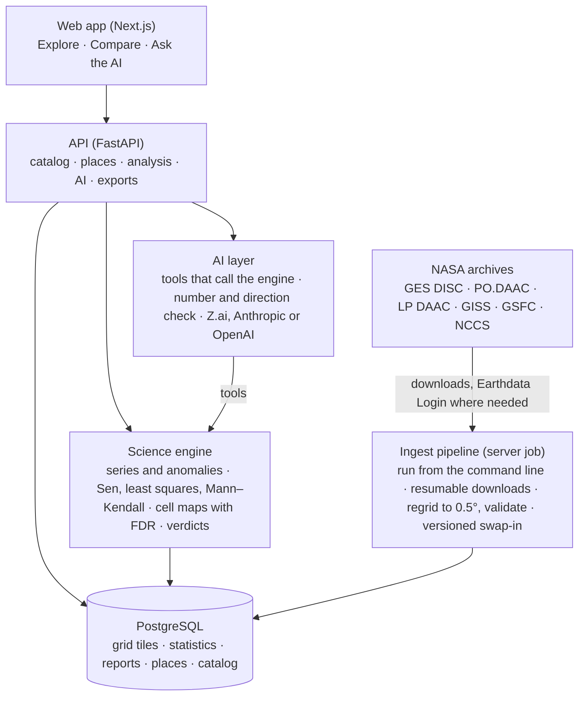

# MegavirTrace — Requirements Specification

NASA Space Apps Challenge 2026, "Be An Earth System Trend Detective!"

## Core idea

MegavirTrace gives anyone an honest, checkable answer to "is this place really changing?" for any of its NASA variables: what is changing, where, how much, and whether it is significant. The tool is built around three commitments, and none of them is ever reduced:

1. **The four questions, for any place, on real NASA data** (FR1, FR3, FR4).
2. **Honest significance:**
    - two independent tests must agree, corrected for year-to-year memory, with false alarms measured;
    - two regions are compared on their difference;
    - a result that isn't significant says how many more years of data would be needed.

    Requirements FR5 and FR10.
3. **Every number traceable:**
    - one deterministic engine computes everything, and the verdict comes from fixed templates;
    - the data are checked against NASA's own tools;
    - AI may explain, but never computes.

    Requirement FR6, plus the engine specification and data design below.

The requirements behind these commitments, plus cost safety (FR20), are the 7 Must requirements.

## Overview

MegavirTrace is a web tool that answers the challenge's four questions for any place on Earth, using real NASA data: what is changing, where, how much, and whether it is significant.

**Team:** Space Pirates Paradigm. Team Leader (Team Owner): Daniel Mumtaz.

**Audience:** the general public. Anyone who wants to know whether a place is changing can use it, with no science background needed. Judges and scientists can also check the method.

**Design goals:**

- **Real data, any region:** at least 10 NASA variables in 5 or more themes, including all six sources the challenge names (MODIS, OMI, AIRS, GPM, MERRA-2, GLDAS).
- **Honest significance:** a trend is called significant only when two independent tests agree. False alarms are measured, not assumed.
- **Plain language:** every verdict is written in everyday words that anyone can follow, and comes from fixed templates, never from AI.
- **Traceable numbers:** every figure on screen can be recomputed from a downloaded notebook.

**Success criteria:**

| Criterion | Target |
| --- | --- |
| Variables | 16 in 7 themes from 11 NASA data products, plus up to 6 more (FR2) |
| Regions | Any drawn box, about 36,000 named places, real country and state outlines |
| Speed | Repeated analysis under 50 ms; first analysis under 2 s |
| False alarms | At most 5% at lag-1 autocorrelation 0.3, at most 7% at 0.5 (Monte Carlo) |
| Data checks | Regional IMERG and MERRA-2 series match NASA Giovanni: correlation at least 0.98, mean difference within 5% |
| Accessibility | No serious or critical WCAG 2.1 AA violations |

**Out of scope:** forecasting, attributing causes, daily extremes (the store is monthly), user accounts and admin pages.

## Users and key scenarios

Two kinds of user need different things: a member of the public needs an answer, and a judge or scientist needs a way to check it.

| User | Wants | Served by |
| --- | --- | --- |
| Member of the public | Pick a place they care about and learn whether it is changing | Explore, the question flow, Ask the AI scientist |
| Judge or scientist | Check the method and reproduce the numbers | Methods paper (FR18), notebook export (FR16), open code |

**Main journeys:**

1. **Explore:** choose *What* (a variable, or the question flow suggests one), then *Where* (search, preset or a drawn box). The chart, the verdict, the statistics and the cell map appear together. The map switches smoothly between a flat 2D map and a 3D globe.
2. **Compare:** the same variable in two regions on one axis. The tool tests whether the two trends really differ, and finds pairs of regions with opposite trends.
3. **Ask the AI scientist:** a question in plain words becomes analyses run by the engine. The AI explains the results, and its numbers are checked against them.
4. **Take it away:** download CSV, Excel, PDF or a notebook that recomputes the result.

## Functional requirements

There are 20 requirements in eight groups: 7 Must, 7 Should and 6 Could. The 7 Must items carry the core idea and cost safety. The *Answers* column names the challenge objective, challenge suggestion or project need that each requirement serves.

- **Must (7):** FR1, FR3–FR6, FR10, FR20
- **Should (7):** FR2, FR7–FR9, FR12, FR14, FR16
- **Could (6):** FR11, FR13, FR15, FR17–FR19

### Data and variables

| ID | Requirement | Answers | Priority |
| --- | --- | --- | --- |
| FR1 | Variable catalog: plain definition, units, source badge, "why it can trend" and caveat for every variable | Objective 1: identify variables | Must |
| FR2 | Six more variables: MODIS land surface temperature and snow cover, MERRA-2 aerosols, CERES energy budget, NSIDC sea ice, OCO-2 carbon dioxide | Objective 1 | Should |

### Place and time series

| ID | Requirement | Answers | Priority |
| --- | --- | --- | --- |
| FR3 | Region selection: search (about 36,000 places), 120+ presets or a drawn box; real outlines for countries and states | Objective 2: acquire for a region | Must |
| FR4 | Regional time series: area-weighted mean with the share of the region covered each month, charted as yearly or seasonal values, monthly anomalies with the seasonal cycle removed, or raw months; table view | Objectives 2 and 3: acquire for a region; time series | Must |

### Trend analysis

| ID | Requirement | Answers | Priority |
| --- | --- | --- | --- |
| FR5 | Trend statistics: Sen's slope, least-squares slope with 95% interval and t-test, and Mann–Kendall, with the tests and intervals corrected for autocorrelation; plus the years of data needed to detect the trend, its size against the noise, and a robustness check | Objective 4: rate and significance; a non-significant trend is still interesting | Must |
| FR6 | Plain-language verdict built from templates, with standing caveats ("a trend is not a cause") | Objective 4 | Must |
| FR7 | Verdicts for trends that are speeding up: a two-piece (breakpoint) or curved fit when a straight line misreads acceleration | Objective 4 | Should |
| FR8 | Trend map inside the region, cell by cell, with false-discovery shading tuned for neighbouring cells that move together (spatially correlated fields, Wilks 2016) | Where it is changing | Should |
| FR9 | Earth view in 2D and 3D: the map switches between a flat 2D map and a 3D globe with a smooth animated transition. Trend colours, region outlines and false-discovery fading look the same in both views. The globe turns by dragging or with the arrow keys, and with reduced motion turned on the switch is instant | Where it is changing | Should |

### Comparison

| ID | Requirement | Answers | Priority |
| --- | --- | --- | --- |
| FR10 | Compare two regions: a test of the difference, plus a finder for regions with opposite trends | Suggestion: opposite trends | Must |
| FR11 | "Moves together" explorer: relationships between variables with a time lag, always labelled "related, not caused by" | Comparing variables | Could |

### Guidance and AI

| ID | Requirement | Answers | Priority |
| --- | --- | --- | --- |
| FR12 | Help choosing a variable: a "Where do I start?" question flow suggests variables by place type and curiosity, and "What is changing here?" tests every variable for one place, with false-discovery control across variables | Objective 1 | Should |
| FR13 | AI scientist that runs the engine through tools, with a Socratic tutor mode that asks guiding questions instead of explaining; the number check stays on in both | Optional AI | Could |

### Context beside the observed trend

| ID | Requirement | Answers | Priority |
| --- | --- | --- | --- |
| FR14 | Ground versus satellite with NASA GLOBE: GLOBE ground observations beside the satellite trend for the same place | NASA resource | Should |
| FR15 | Climate projections: a NASA NEX-GDDP-CMIP6 subset beside the observed trend, with strong caveats | Context | Could |

### Sharing and openness

| ID | Requirement | Answers | Priority |
| --- | --- | --- | --- |
| FR16 | Downloads: CSV, Excel, PDF and a notebook that recomputes the result | Reproducibility | Should |
| FR17 | Reuse outside the app: embeddable trend cards for websites, blogs and local news, carrying source and checks; and an open data API, documented, read-only and rate-limited | Reach | Could |
| FR18 | Methods paper draft and contributor guide in the repository | Openness | Could |

### Access and safe operation

| ID | Requirement | Answers | Priority |
| --- | --- | --- | --- |
| FR19 | Wider reach: several interface languages (English and Spanish first); works on weak connections, offline after one visit, with lightweight, phone-first pages | Reach | Could |
| FR20 | Security and cost: strict Origin check, lock file, secret scan, dependency audit, AI limits on by default with a daily cap, and keys kept only in the server's configuration | Safe operation | Must |

## Data design

Eleven NASA data products (MERRA-2 supplies two of them) feed one monthly store on a common 0.5° grid (AIRS and GISTEMP keep their coarser grids): 16 variables and about 41 GB of raw downloads. Eight of the products need an Earthdata Login; three are public.

| Variable(s) | Product | Archive and access | Grid: native → stored | Record from | Expected download |
| --- | --- | --- | --- | --- | --- |
| Nitrogen dioxide (NO₂) | OMI `OMNO2d` v004, daily | GES DISC, OPeNDAP (NO₂ field only) | 0.25° daily → 0.5° monthly | 2004-10 | 16 GB, 8,025 files |
| Topsoil moisture, soil moisture 0–100 cm, evapotranspiration (+ drought months, derived) | GLDAS Noah 2.1 `GLDAS_NOAH025_M` | GES DISC, earthaccess | 0.25° → 0.5° | 2000-01 | 7.5 GB |
| Rainfall | GPM IMERG Final `GPM_3IMERGM` V07 | GES DISC, earthaccess | 0.1° → 0.5° | 2000-06 | 5.9 GB |
| Fire carbon emissions | MiCASA v1 | Public copy at NASA NCCS | 0.1° → 0.5° | 2001-01 | 4.9 GB |
| Vegetation greenness (NDVI) | MODIS/Terra `MOD13C2` v061 | LP DAAC, OPeNDAP (NDVI only) | 0.05° → 0.5° | 2000-02 | 2.8 GB |
| Sea level | NASA-SSH v1, weekly | PO.DAAC | weekly → monthly 0.5° | 1992-11 | 1.9 GB |
| Daily high, nightly low, downpour intensity | MERRA-2 `M2SMNXSLV` | GES DISC, OPeNDAP (3 fields) | 0.5° × 0.625° → 0.5° | 1980-01 | 0.9 GB |
| Water stored on land | GRACE/GRACE-FO mascons | NASA GSFC, public | mascons → 0.5° | 2002-04 | 0.5 GB |
| Air temperature (2 m) | MERRA-2 `M2TMNXSLV` | GES DISC, OPeNDAP (T2M only) | 0.5° × 0.625° → 0.5° | 1980-01 | 0.3 GB |
| Ground and sea surface temperature | AIRS `AIRS3STM` v7 | GES DISC, OPeNDAP (2 fields) | 1° (kept) | 2002-09 | 0.15 GB |
| Surface temperature change | GISTEMP v4 | NASA GISS, public HTTPS | 2° (kept) | 1880-01 | 25 MB |

The table includes all six sources the challenge's Background names (MODIS, OMI, AIRS, GPM, MERRA-2 and GLDAS). Each product is cited, with its DOI where one exists.

### Test data first, full download after development

The full download is large (about 41 GB; OMI alone is 8,025 daily files) and takes a long time. Development and testing therefore run on a small test dataset. The full download happens only after development is finished.

1. **During development: small test data, for testing only.**
    - **Area:** one test box of about 5° × 5° (about 100 cells at 0.5°). The NASA Giovanni reference series uses the same box, so the test data can be validated.
    - **Period:** the most recent 10 years for monthly products, enough for the trend engine to run; the most recent 12 months for weekly and daily products (NASA-SSH, OMI).
    - **How:** the same download code that will later fetch everything, asking the archive for the test box only (OPeNDAP or the archive's subsetting service), so each file stays small. Small products such as GISTEMP (25 MB) are fetched whole.
    - **Use:** test data are only for building and testing. They are stored as their own grid version, labelled as test data, and never presented as real results.
    - **Measure:** the test downloads record the time and size per product, to plan the full download.
2. **After development: the full download.** When the pipeline, engine, API and pages all work on the test data, the full download runs in the background. Each product is validated (quick-look map and global mean, plus the Giovanni check for IMERG and MERRA-2) and swapped in as a new grid version, replacing the test data.

### Downloads and harmonisation

Where the archive offers OPeNDAP, only the fields needed are requested. Downloads resume after a break.

**Harmonisation rules:**

- **Grid:** conservative regridding to 0.5°, which keeps the global mean. Coarser products (AIRS 1°, GISTEMP 2°) stay on their own grid.
- **Time:** monthly means. For a daily product (OMI), a month needs at least 3 days with data.
- **Everyday units:** mm per month instead of mm/hr or kg/m²/s; °C instead of K.
- **Known traps, checked per product:** IMERG is stored longitude-first. Some grids run 0–360° or start at 60°S. Fill values differ by product.
- **Masks:** land variables only over land, sea level only over the sea. A region with no valid cells gets a clear message.

**Provenance catalog:** one entry per variable, with:
- product, version and DOI (where one exists);
- units, grid and record span;
- a plain definition, "why it can trend" and its caveat;
- the citation string.

**Validation before use:**

- **Global means:** checked for plausibility, for example IMERG rainfall about 2.7 mm per day (about 82 mm per month).
- **Maps:** a quick-look PNG per product, to see that the continents are in the right place.
- **Giovanni:** area averages for the test box match NASA Giovanni (IMERG and MERRA-2), first on the test data and again on the full download.
- **GISTEMP:** our global series matches NASA's official one, including the warming rate and the warmest year.

**Storage:** PostgreSQL. Grids are kept as compressed 20 × 20-cell tiles, so a region reads only the tiles it touches.

- **Versions:** each import writes a new grid version and swaps it in within one transaction.
- **Statistics:** computed once per data version and reused.
- **Raw files:** stay on disk, so an import can be rerun without downloading again.

## System architecture

Three layers sit on one database: a Next.js web app, a FastAPI service, and a Python science engine. The AI layer can reach data only through the engine's tools. Every number comes from that one engine.



The ingest pipeline is the only part that talks to NASA. Pages (through the API) and the AI (through the engine's tools) read finished grids and stored statistics from PostgreSQL.

| Endpoint | Purpose |
| --- | --- |
| `GET /variables`, `GET /datasets` | The catalog: definitions, units, sources, records |
| `GET /places/search?q=`, `GET /places/{id}` | Place search and outlines |
| `POST /analysis/trend` | One region: series, statistics, verdict, optional cell map |
| `POST /analysis/compare` | Two regions and the difference test |
| `POST /analysis/scan`, `GET /analysis/opposites` | Every variable for one place; regions with opposite trends |
| `POST /ai/ask`, `POST /ai/explain` | AI scientist; `explain` takes an analysis id, never numbers sent by the client |
| `GET /reports/{id}`, `GET /reports/{id}/export?format=` | Saved results; CSV, Excel, PDF, notebook |

There are no admin pages and no admin endpoints. Data imports run as a server job, started from the command line. The AI services, models, keys and limits, and the Earthdata Login, are set in the server's configuration.

## Scientific engine specification

The engine is deterministic, runs only on the server and is the single source of every number. A result is "significant" only when an autocorrelation-corrected Mann–Kendall test and the least-squares interval agree.

1. **Aggregate.** Monthly values become yearly values (at least 10 of 12 months) or a season's values (3 of 3 months). In monthly mode, the seasonal cycle is removed: each month minus that month's average over the chosen years.
2. **Least-squares trend.** Slope per decade, 95% interval and t-test. The standard error is widened with the effective sample size, using the lag-1 autocorrelation r₁ of the residuals.
3. **Small-sample correction of r₁.** Residuals of a fitted trend underestimate r₁ by about (2 + 4r₁)/n. That is up to twice the correction for a series with only its mean removed, (1 + 3r₁)/n. The engine uses the trend version (van Giersbergen 2005).
4. **Mann–Kendall.** S, Z, Kendall's τ and p, with the variance corrected for AR(1) autocorrelation. Monthly mode uses the seasonal test. The Hamed–Rao correction is not used; the AR(1) correction is the one the Monte Carlo false-alarm tests check.
5. **Sen's slope** with its 95% interval. This is the headline rate, because it resists outliers.
6. **Agreement rule.** "Significant" needs both tests at α = 0.05. A Monte Carlo test in CI holds the false-alarm rate to the targets in the overview.
7. **Years needed to detect** a trend of this size, from its noise and autocorrelation (Weatherhead et al. 1998). A non-significant verdict says how many more years a record would need.
8. **Size against the noise:** how far the trend line moves over the record, divided by the scatter around it. It is labelled small, moderate, large or very large.
9. **Robustness.** Sen's slope must keep its sign in both halves of the record, without the first and last years, and with any one year left out. If it doesn't, the trend is labelled "fragile".
10. **Where inside the region.** A vectorised Sen slope and Mann–Kendall test runs on every cell, followed by Benjamini–Hochberg q-values, tuned for neighbouring cells that move together (Wilks 2016).
    - Cells that don't pass are faded, and a toggle shows the raw view.
    - A caveat says that which cells pass depends on the region tested.
11. **Comparing two regions.** The test is on the trend of the year-by-year difference series, region A minus region B (Santer et al. 2000).
    - Shared ups and downs cancel, so regions that move together are not under-tested, and regions that move apart are not over-tested.
    - The output is the difference per decade, its 95% interval, p, and the smallest difference the record could detect.
12. **Extra clues** (exploratory, labelled as such):
    - unusual years, more than 2 SD from the trend line;
    - a turning point;
    - a z-score with rank for any single month.

```latex
n_{\mathrm{eff}} = n\,\frac{1 - r_1}{1 + r_1}
```

```latex
n^{*} = \left[\frac{3.3\,\sigma_N}{|\omega|}\sqrt{\frac{1+\phi}{1-\phi}}\right]^{2/3}
```

In the first formula, n is the number of values in the series: years, or months in monthly mode. In the second, n* is the years needed to detect a trend ω per year, with noise σ_N and autocorrelation φ (Weatherhead et al. 1998).

## AI Earth Scientist

The AI is optional and never computes. It turns a question into calls to the engine and explains the results. If it states a number the results don't contain, the template verdict is shown instead.

**Tools it may call:** `list_variables`, `find_places`, `run_trend_analysis`, `compare_regions` and `scan_region`. The first two return catalog entries and places; the three analysis tools return an analysis id and the stored statistics.

**The number check:**

- **What is checked:** every number in the AI's headline and explanation must match a number in the referenced analyses, within rounding.
- **Digits in every script:** numbers are read the way each language writes them, using the Unicode CLDR data (decimal mark, grouping, native digits). That covers:
  - Arabic-Indic, Persian, Devanagari and full-width digits;
  - the full-width decimal point and a decimal comma;
  - Indian digit grouping.
- **Direction words:** "rising", "falling" and their translations are checked against the slope's sign. A number check alone cannot catch a reversed direction.
- **Small numbers:** whole numbers 0–10 are exempt only when they carry no unit, so "2 °C per decade" is still checked.
- **Cards from the stored results:** the statistics cards and charts are always drawn from the stored analysis JSON, never from the AI's text.

**Services:** one conversation interface with two kinds of connection:
- OpenAI-style chat completions, for Z.ai's GLM (the default), OpenAI and any compatible service;
- Anthropic's Messages API, with structured output.

How they are managed:
- Services, models and keys are set in the server's configuration. There is no admin page.
- A key is sent only to its own service's address, never to the browser.
- If the service fails, the visitor gets the computed verdict and the failure is counted.

**Cost controls (on from the first deploy):**

- **Per visitor:** a default hourly limit per IP address, for example 20 questions per hour. There is no sign-in to count by.
- **Whole site:** a daily cap; past it, every visitor gets the computed verdict.
- **At each provider:** a spend limit set in its own console, with a key used only by this site.
- **Records:** a daily count of answers, fallbacks and failures, plus the tokens used, kept in the server log.

## Non-functional requirements

The tool must be fast, usable by everyone, safe to leave running, and checkable by a judge.

| Area | Requirement | Target or rule |
| --- | --- | --- |
| Performance | Statistics computed once per data version and stored | Repeat analysis under 50 ms; first under 2 s; one region reads only its tiles |
| Accessibility | WCAG 2.1 A and AA; keyboard use; a data-table view for every chart | No serious or critical axe-core violation, checked in CI in light and dark themes |
| Languages | Verdicts built from each language's templates; right-to-left layout | English at launch; with FR19, Spanish next and 8 as the target, Arabic included |
| Security | No sign-in and no cookies; strict Origin check; keys only in the server's configuration | No secret in the repository or sent to the browser |
| Supply chain | Locked dependency versions | Lock file, secret scan and dependency audit in CI |
| Reproducibility | Fingerprint per result; data version per grid; notebook export | The notebook recomputes every number and checks it against the app |
| Cost | AI limits per visitor and per day, plus provider spend limits | No unbounded AI spending from day one |
| Operations | One server: nginx, two processes, PostgreSQL; resumable imports; nightly backup | A recorded demo and a local run as fallbacks for the judging |
| Openness | Open source with every data source cited | Public repository; Apache 2.0, the Space Apps default |

## Testing and validation strategy

Every layer is checked against something independent: the statistics against reference libraries, the data against NASA's own tools, and the AI against the stored results.

| Layer | Check | Passes when |
| --- | --- | --- |
| Statistics | Uncorrected statistics (Mann–Kendall S and τ, Sen's slope, least-squares slope) compared with `scipy` and `pymannkendall` on random series | Identical within floating-point error |
| Statistics | Monte Carlo on AR(1) series, 2,000 runs per setting | False alarms within the targets; a synthetic trend recovered inside its 95% interval |
| Comparing regions | Monte Carlo on correlated pairs (correlation from −0.5 to 0.95) | False alarms near 5% whatever the correlation |
| Cell maps | The vectorised engine compared with the per-series engine | Same slope and p for every sampled cell |
| Data | Quick-look PNGs and global means for each product | Continents in place; means within published ranges |
| Data | Giovanni area averages for the test box and the same months (IMERG and MERRA-2), on the test data and again on the full download | Correlation at least 0.98; mean difference within 5% |
| Ingest | Readers run on fake files in each product's real layout | Orientation, units and fill values handled |
| API | Every endpoint on a small synthetic store | All pass in CI on PostgreSQL |
| AI | Fake clients; a wrong number in each supported language; a reversed direction | Every wrong answer falls back to the template |
| Browser | Scripted flows through every page, plus the axe-core accessibility gate | No failing step, no page error, no serious violation |
| Content | Fact sources resolved on Crossref; one human read of every fact | DOI and title match; the text agrees with its sources |
